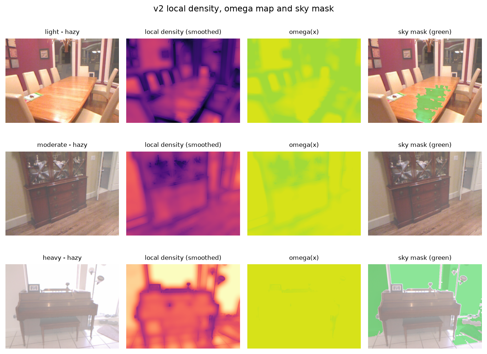
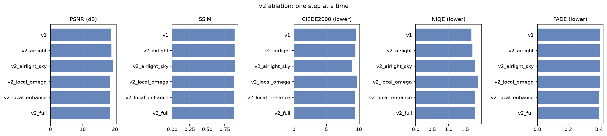

# FogSense: An Intelligent Multi-Algorithm Framework for Adaptive Haze Removal

**IPA course project — final report**

> Every numeric value in this report is generated from files under `results/`.
> Regenerate v1 with `./run_all.ps1` (or the individual scripts listed in the README);
> regenerate v2 with `./run_all_v2.ps1`.

---

## Abstract

Haze scattering reduces contrast and colour fidelity, and a fixed-parameter dehazer
applies the same correction to light and dense fog. We present **FogSense**, a classical,
density-aware, multi-algorithm framework that estimates a fog-density score from three
image statistics, selects a light / moderate / heavy strategy, applies Dark Channel Prior
(DCP) dehazing with class-specific parameters refined by a guided filter, and then
optionally applies Retinex illumination correction, CLAHE and gray-world colour
correction. We compare the adaptive pipeline against a fixed-parameter DCP baseline. On 243 held-out SOTS
pairs the adaptive pipeline improves PSNR from 15.71 dB to 18.78 dB and SSIM from
0.8263 to 0.8896, with a 96.3% PSNR win rate and improvements in every estimated haze
class. We also report a no-reference real-world RTTS set, component/feature/selector
ablations, runtime and failure cases. An opt-in v2 extension (v2 airlight/sky, local
density maps, stronger CAP/BCCR baselines) is evaluated separately in §9: it improves
indoor SOTS and CIEDE2000 but does **not** beat v1 on aggregate SOTS PSNR/SSIM, and the
stronger CAP baseline narrows the adaptive PSNR advantage.

---

## 1. Introduction

Fog and haze scatter and attenuate light before it reaches the camera. The observed
image can be described by the atmospheric scattering model:

```
I(x) = J(x) t(x) + A (1 - t(x)),    t(x) = exp(-beta d(x))
```

where `J` is the clear scene radiance, `A` the atmospheric light, `t` the transmission
and `beta d(x)` the optical depth. Inverting the model requires estimating `A` and `t`.

A standard Dark Channel Prior (DCP) uses one fixed correction strength for every
image. On light haze this over-corrects (dark, unnatural results, lost colour); on dense
haze it under-corrects. The project hypothesis is that **estimating fog density first
and adapting the correction strength and enhancement strategy** yields more consistent
results across haze levels.

We call the resulting framework **FogSense**. It is *multi-algorithm* because the same
density-aware interface can dispatch the adaptive DCP pipeline and the fixed DCP, CAP and
BCCR-style baselines, and *intelligent* in the sense of density-aware rule-based
adaptation, not a trained deep network. The v2 extension adds an optional atmospheric-
light/sky stage and local density maps; §9 evaluates it honestly against v1.

Contributions:

1. A label-free fog-density score built from dark-channel mean, entropy and contrast,
   normalised on a calibration split and validated against known `beta`.
2. A rule-based, per-class parameter selector with two optional ablations
   (continuous interpolation, shallow decision tree).
3. A fully reproducible classical pipeline and evaluation harness with per-class
   PSNR/SSIM, no-reference metrics, runtime, ablations and a Streamlit demo.

---

## 2. Related work

**Dark Channel Prior.** He et al. observed that in haze-free outdoor images at least one
colour channel is close to zero in most local patches. The dark channel therefore
estimates haze thickness; transmission is `1 - omega * dark(I/A)` and the scene is
recovered by inverting the scattering model. A transmission floor `t0` limits noise
amplification.

**Guided filter.** He et al. refine the noisy transmission map with an edge-preserving
linear filter. We implement the box-filter version locally, so OpenCV-contrib is not
required.

**CLAHE.** Zuiderveld's contrast-limited adaptive histogram equalisation improves local
contrast with a clip limit that prevents noise amplification. We apply it on the L
channel in LAB to preserve hue and saturation, and blend the equalised luminance with
the dehazed image (strength 0.4) to avoid over-sharpening on benchmark pairs.

**Retinex.** Jobson et al. model illumination as a smooth component; subtracting
Gaussian-blurred log-luminance yields a reflectance-like image. We use multi-scale
Retinex on luminance and preserve colour via a gain map.

**Gray-world.** The average scene colour is assumed gray; per-channel gains remove
residual colour cast after dehazing.

---

## 3. Method

### 3.1 Preprocessing
Images are converted to RGB float32 in `[0, 1]`, resized so the long side is 640 px
(area interpolation for downscaling), and lightly denoised with a bilateral filter
(diameter 5, sigma 20). The same preprocessing is used by baseline and adaptive methods.

### 3.2 Fog-density estimation
For each image we compute:

* **dark-channel mean** with a 15×15 patch (higher = hazier),
* **Shannon entropy** of the grayscale histogram (lower = hazier),
* **global contrast** = mean of RMS contrast and Michelson contrast (lower = hazier).

Each feature is percentile-normalised (`p2`–`p98`) using statistics fitted on the
**calib** split only. The score is

```
score = 0.45 * ndc + 0.30 * (1 - nentropy) + 0.25 * (1 - ncontrast)
```

and lies in `[0, 1]`. The three weights live in `config/params.yaml`; the fitted
normalisation and thresholds live in `config/calibration.json`.

### 3.3 Adaptive strategy selection
Thresholds `t1`, `t2` are the tertiles of the calibration score distribution. Images
below `t1` are **light**, between `t1` and `t2` **moderate**, above `t2` **heavy**.
Each class has its own `omega`, `t0`, guided-filter radius/epsilon, CLAHE clip and
Retinex strength. Parameters are fitted on calib with a constrained two-stage search
(omega × t0, then CLAHE clip × Retinex strength); constraints encode the physical prior
that correction strength increases with density.


Optional variants used as ablations:

* **continuous**: interpolate `omega`, `t0`, CLAHE clip and Retinex strength from the
  score rather than using three bins;
* **classifier**: depth-3 decision tree on the three normalised features, trained on
  labelled synthetic haze.

### 3.4 Dehazing and enhancement
DCP estimates the atmospheric light from the brightest 0.1% of dark-channel pixels,
computes the transmission map, refines it with the guided filter, and recovers radiance
with `J = (I - A) / max(t, t0) + A`. The class-specific enhancement chain is
**Retinex → CLAHE → gray-world**, each step individually switchable.

### 3.5 Evaluation
Full-reference on SOTS: PSNR and SSIM against clear ground truth. No-reference on all
sets: entropy gain, RMS contrast improvement, Sobel edge-preservation ratio and colour
cast. Runtime is measured per image on CPU. Adaptive and baseline are paired by image;
we report win rate and a Wilcoxon signed-rank test.

---

## 4. Experimental setup

| item | value |
|---|---|
| Dataset | SOTS indoor + outdoor (RESIDE), 542 unique clear scenes |
| Calibration | 299 pairs (55%), split by unique clear scene |
| SOTS test | 243 pairs (45%) |
| No-reference set | 72 real RTTS images (RESIDE-beta, no ground truth) |
| Density validation | 8 scenes × 8 beta values = 64 images |
| Image size | long side 640 px |
| Baseline | DCP: omega 0.95, t0 0.10, patch 15, GF r=60 eps=1e-4, no enhancement |
| Adaptive | class-specific params from `config/tuned_params.json` |
| Runtime | CPU, Python 3.12, OpenCV |

The calibration split is used for the density normalisation, tertile thresholds and
the per-class parameter search. The classifier ablation is trained on the separate
180-image synthetic selector set, using the calibration normalisation. Test sets are
evaluated only after `config/tuned_params.json` is written and the repository is
tagged `v0.1-frozen-params`.

Frozen parameters (all fitted on calib only):

| class | omega | t0 | CLAHE clip (blend 0.4) | Retinex strength |
|---|---|---|---|---|
| light | 0.86 | 0.35 | 1.5 | 0.00 |
| moderate | 0.94 | 0.30 | 1.5 | 0.35 |
| heavy | 0.94 | 0.20 | 1.5 | 0.00 |

---

## 5. Results

### 5.1 Density estimation


The density score rises with `beta` for every scene. Overall Spearman correlation and
the stricter within-scene mean are reported in
`results/density_validation_summary.json`. The score distributions per split and per
selected haze class are shown below; the calibration tertiles give three balanced bins.


### 5.2 Baseline vs adaptive

<!-- RESULTS_TABLE_START -->
| split | class | method | psnr | ssim | entropy_gain | contrast_improvement | edge_preservation | total_ms |
|---|---|---|---|---|---|---|---|---|
| test_rtts | all | adaptive |  |  | 0.4165 | 1.2376 | 1.6733 | 184.2860 |
| test_rtts | all | baseline |  |  | 0.0912 | 1.0648 | 1.1967 | 93.6030 |
| test_rtts | heavy | adaptive |  |  | 0.9994 | 1.5693 | 1.9917 | 145.9313 |
| test_rtts | heavy | baseline |  |  | 0.7749 | 1.4211 | 1.5967 | 91.6385 |
| test_rtts | light | adaptive |  |  | 0.0992 | 1.0358 | 1.3885 | 148.0721 |
| test_rtts | light | baseline |  |  | -0.1971 | 0.8918 | 0.9888 | 95.4192 |
| test_rtts | moderate | adaptive |  |  | 0.5391 | 1.3865 | 2.1562 | 389.0011 |
| test_rtts | moderate | baseline |  |  | -0.0773 | 1.0615 | 1.2441 | 90.4050 |
| test_sots | all | adaptive | 18.7750 | 0.8896 | 0.4258 | 1.3095 | 1.8484 | 256.1686 |
| test_sots | all | baseline | 15.7100 | 0.8263 | 0.1929 | 1.2406 | 1.3360 | 87.1733 |
| test_sots | heavy | adaptive | 16.5079 | 0.8672 | 0.6102 | 1.5378 | 1.9581 | 148.3146 |
| test_sots | heavy | baseline | 15.1354 | 0.8225 | 0.4889 | 1.4919 | 1.5858 | 87.3722 |
| test_sots | light | adaptive | 19.8208 | 0.9064 | 0.1774 | 1.1255 | 1.5760 | 152.1749 |
| test_sots | light | baseline | 16.5759 | 0.8399 | -0.0151 | 1.0658 | 1.2070 | 88.7939 |
| test_sots | moderate | adaptive | 19.4352 | 0.8902 | 0.5232 | 1.3156 | 2.0214 | 429.6232 |
| test_sots | moderate | baseline | 15.3221 | 0.8165 | 0.1727 | 1.2217 | 1.2759 | 85.5335 |
<!-- RESULTS_TABLE_END -->


<!-- KEY_FINDINGS_START -->
### Key findings

- **Density validation.** The score is monotone in beta: overall Spearman rho = 0.907; within-scene mean rho = 0.992 (minimum 0.939 across 8 scenes).

- **SOTS overall.** Adaptive PSNR 18.78 dB vs baseline 15.71 dB; SSIM 0.8896 vs 0.8263. Win rate (adaptive > baseline): PSNR 96.3%, SSIM 90.1%.

- **Per class.** light: delta PSNR +3.24 dB, delta SSIM +0.0665, SSIM win rate 90.6%; moderate: delta PSNR +4.11 dB, delta SSIM +0.0737, SSIM win rate 88.0%; heavy: delta PSNR +1.37 dB, delta SSIM +0.0446, SSIM win rate 92.4%.

- **Real RTTS no-reference set (72 images, no ground truth).** entropy_gain delta +0.3253; contrast_improvement delta +0.1728; edge_preservation delta +0.4767.

- **Runtime.** 256 ms/image (3.9 FPS) on CPU, including preprocessing.

- **Ablation.** Full pipeline SSIM 0.8896 vs no-enhancement 0.8726; dark-channel-only density features give SSIM 0.8831 vs full features 0.8896.
<!-- KEY_FINDINGS_END -->

### 5.3 Transmission maps


### 5.4 Runtime


On CPU the full adaptive pipeline takes about 256 ms per 640-px image (3.9 FPS),
compared with about 69 ms for the fixed DCP baseline. The overhead comes from the
density features and the enhancement chain (Retinex is the most expensive step). The
class-specific enhancement settings keep the cost bounded; Retinex is disabled for
light and heavy classes.

### 5.5 No-reference real-world set (RTTS)

The no-reference set contains 72 real RTTS photographs (RESIDE-beta), downloaded
with `scripts/download_rtts.py` from the `fuhao7i/RTTS` mirror (Apache-2.0). RTTS has
no ground-truth clear image, so only no-reference metrics are reported: entropy gain,
RMS contrast improvement, Sobel edge-preservation ratio and colour cast.


### 5.6 Baseline fairness audit

To make sure the fixed DCP baseline is not accidentally handicapped, `scripts/audit_baseline.py`
re-runs it on 20 evenly spaced SOTS test images and compares the default estimator
against alternatives (`results/baseline_audit_summary.csv`):

| baseline variant | PSNR (dB) | SSIM | mean A |
|---|---|---|---|
| current (top-0.1% mean, guided filter r=60) | 15.44 | 0.8330 | 0.941 |
| brightest dark-channel pixel | 15.42 | 0.8332 | 0.943 |
| top-1% mean atmospheric light | 15.59 | 0.8342 | 0.934 |
| no guided filter | 14.59 | 0.7752 | 0.941 |
| native resolution (no resize/denoise) | 17.02 | 0.8546 | 0.939 |

The atmospheric-light estimator and the guided filter are therefore *helping* the
baseline, not hurting it. The native-resolution variant scores higher because the shared
`640 px` preprocessing (resize + bilateral) costs about 1.6 dB on both methods; since
baseline, adaptive and ground truth all use the same preprocessing, the paired comparison
remains fair. Three visual examples are shown below.


---

## 6. Ablations


<!-- ABLATION_TABLE_START -->
| variant | group | n | psnr | ssim | entropy_gain | contrast_improvement | edge_preservation | color_cast_out | runtime_ms |
|---|---|---|---|---|---|---|---|---|---|
| baseline_dcp | baseline | 243 | 15.7100 | 0.8263 | 0.1929 | 1.2406 | 1.3360 | 0.0376 | 69.1058 |
| adaptive_no_enh | component | 243 | 17.7705 | 0.8726 | 0.2428 | 1.3319 | 1.3835 | 0.0337 | 99.8213 |
| adaptive_clahe | component | 243 | 18.1839 | 0.8850 | 0.3697 | 1.3173 | 1.7287 | 0.0339 | 116.0220 |
| adaptive_clahe_retinex | component | 243 | 19.3042 | 0.8840 | 0.5337 | 1.3151 | 2.0560 | 0.0389 | 399.6646 |
| adaptive_full | component | 243 | 18.7750 | 0.8896 | 0.4258 | 1.3095 | 1.8484 | 0.0187 | 235.3790 |
| density_dc_only | density_features | 243 | 18.4767 | 0.8831 | 0.4121 | 1.2985 | 1.8218 | 0.0185 | 232.4757 |
| density_dc_entropy | density_features | 243 | 18.8355 | 0.8901 | 0.4276 | 1.3099 | 1.8496 | 0.0183 | 241.1430 |
| density_full | density_features | 243 | 18.7750 | 0.8896 | 0.4258 | 1.3095 | 1.8484 | 0.0187 | 235.8943 |
| selector_continuous | selector | 243 | 18.8002 | 0.8574 | 0.5385 | 1.2317 | 2.1860 | 0.0170 | 412.2332 |
| selector_classifier | selector | 243 | 18.4006 | 0.8780 | 0.4464 | 1.3053 | 1.8592 | 0.0201 | 294.0795 |
<!-- ABLATION_TABLE_END -->

**Components.** Removing all enhancement lowers SSIM from 0.8896 to 0.8726 and PSNR
from 18.78 to 17.77 dB, so the enhancement chain is doing real work beyond DCP.
CLAHE alone reaches 18.18 dB / 0.8850. Adding Retinex to CLAHE raises PSNR to
19.30 dB but lowers SSIM to 0.8840, showing the expected detail/noise trade-off; the
full pipeline keeps Retinex only for moderate haze and adds gray-world, which gives
the best SSIM (0.8896) and the lowest colour cast (0.0187 vs 0.0389 for
CLAHE+Retinex). This is why the final selector does not simply enable every
enhancement for every class.

**Density features.** Dark-channel-only density reaches 18.48 dB / 0.8831; adding
entropy gives 18.84 dB / 0.8901, and adding contrast gives 18.78 dB / 0.8896. Entropy
therefore carries most of the density signal on SOTS, while contrast is close to
neutral; we keep all three because they are complementary on the beta sweep and on
real low-contrast images. The small 0.0005 SSIM difference between the
entropy-only and full score is within run-to-run and sampling noise, so we do not
claim a significant advantage for the third feature.

**Selector.** Continuous interpolation reaches 18.80 dB but only 0.8574 SSIM,
because it over-enhances some images; the depth-3 classifier reaches
18.40 dB / 0.8780, below the three-bin rule (18.78 dB / 0.8896). The three-bin
selector is therefore retained as the primary method: it is simpler, interpretable
and best on SSIM, while continuous/classifier remain useful ablations.

---

## 7. Failure cases and limitations


* **Sky and white objects** violate the dark-channel assumption; transmission is
  underestimated and these regions darken or shift colour.
* **Night haze** has low illumination and weak colour statistics; the density score is
  less reliable.
* **Noise amplification** occurs in dense haze because `J` divides by a small `t`;
  the `t0` floor trades detail for noise.
* **CLAHE/Retinex** can over-sharpen texture and amplify compression artefacts.
* **RTTS**: real RTTS images carry no clear ground truth, so the no-reference metrics
  only indicate whether detail/contrast entropy increase; they are not a substitute for
  paired PSNR/SSIM. The exact 72-image subset is reproducible with
  `scripts/download_rtts.py`.
* **Haze class on SOTS** is estimated from the density score (SOTS has no per-image
  beta label), so the per-class split is an operational definition, not ground truth.

---

## 8. Conclusion

A density-aware classical pipeline gives a principled way to vary DCP strength and
enhancement across haze levels while remaining explainable and CPU-friendly. The
evaluation harness reports both full-reference and no-reference metrics, per-class
behaviour, ablations, runtime and failure cases, and every number is reproducible from
the committed scripts and CSVs.

---

<!-- V2_SECTION_START -->
## 9. v2 upgrade (opt-in)

v1.0 remains the default. This section describes a separate, opt-in v2 pipeline. With every v2 flag off the output is byte-identical to v1.0 (`tests/test_v2_compat.py`). All v2 knobs were fitted on the **calib** split only and frozen at tag `v2.0-frozen-params` before the first v2 test-split run; the v1 tables above are unchanged.

### 9.1 Atmospheric light and sky handling

v2 atmospheric light takes the brightest 0.5% of dark-channel pixels, rejects small connected components (< 0.05% of pixels) and high-gradient pixels (> 60th percentile of Sobel magnitude), then averages the survivors; if too few survive it falls back to v1. A quad-tree sky search (score = mean - std, recurse on the best quadrant) is implemented as an alternative. A conservative sky mask (bright >= 0.80, smooth gradient <= 0.04, connected area >= 2% of the image) floors transmission at 0.25 and blends the output 25% toward the input inside the mask.

Calib comparison (36 images, 29 containing sky):

| method | n | psnr | ssim | objective |
|---|---|---|---|---|
| v1 | 36 | 19.2573 | 0.8607 | 0.6858 |
| v2 | 36 | 19.3708 | 0.8596 | 0.6859 |
| quadtree | 36 | 18.3785 | 0.8405 | 0.6665 |

On calib the v2 airlight changes PSNR by +0.11 dB and SSIM by -0.0011 relative to v1 (objective essentially tied); the quad-tree search is -0.88 dB worse, so it is not used. The v2 gain is therefore not an average-case PSNR gain; it is a failure-case/sky intervention, which is why it is kept opt-in.

### 9.2 Local density and per-pixel parameters

A sliding-window density map is built from local dark-channel mean, rank entropy (disk radius 15) and local RMS contrast, normalised with calib-only statistics (`config/calibration_local.json`). The map is guided-filter smoothed (radius 15, eps 1e-3). `omega(x)` and `t0(x)` are interpolated from the three per-class values at the calibration class centroids; omega is forced non-decreasing and t0 non-increasing in density, with bounds omega in [0.70, 0.97], t0 in [0.05, 0.40]. Enhancement is blended spatially as `out = (1-alpha) * dehazed + alpha * enhanced`, `alpha = floor + (1-floor) * score_map`; calib selected `floor = 0.0`, i.e. enhancement proportional to local density.



### 9.3 Stronger baselines and metrics

* **CAP** (Zhu et al., 2015): published theta coefficients, fixed `beta = 1.0`, `t0 = 0.10`; atmospheric light from the brightest 0.1% of the depth map.
* **BCCR-style** (Meng et al., 2013): the dark-channel transmission is projected onto the physical boundary constraint `0 <= J <= 1` and refined with the guided filter. This is a simplified BCCR, not the full L1 contextual solver.
* **CIEDE2000**: mean colour difference in Lab (lower is better).
* **NIQE-style**: 20 MSCN statistics at two scales, multivariate Gaussian fitted on the 299 **calib clear** images (lower is better). The official NIQE model is not shipped.
* **FADE-style**: the Choi et al. (2015) feature set (dark channel, contrast, saturation, colourfulness, entropy) with fixed documented weights (lower = clearer). The official learned FADE model is not shipped. Both no-reference indices are therefore *style* proxies and should be read as relative trends, not absolute scores.

### 9.4 Test results

**SOTS test (243 pairs), identical preprocessing for every method:**

| method | n | psnr | ssim | ciede2000 | niqe_out | fade_out | entropy_gain | contrast_improvement | edge_preservation | color_cast_out | runtime_ms |
|---|---|---|---|---|---|---|---|---|---|---|---|
| bccr | 243 | 16.0186 | 0.8309 | 12.3553 | 1.2665 | 0.3753 | 0.2013 | 1.2669 | 1.3483 | 0.0362 | 83.0597 |
| cap | 243 | 18.0912 | 0.7833 | 9.8354 | 2.0313 | 0.3911 | 0.1184 | 1.3909 | 1.2552 | 0.0311 | 38.1772 |
| dcp | 243 | 15.7100 | 0.8263 | 12.6387 | 1.3106 | 0.3735 | 0.1929 | 1.2406 | 1.3360 | 0.0376 | 59.3772 |
| v1 | 243 | 18.7750 | 0.8896 | 9.5014 | 1.6850 | 0.4051 | 0.4258 | 1.3095 | 1.8484 | 0.0187 | 192.3152 |
| v2 | 243 | 18.4503 | 0.8873 | 9.3814 | 1.7943 | 0.4007 | 0.3202 | 1.3307 | 1.5837 | 0.0244 | 561.7177 |

**Real RTTS (72 images, no ground truth):**

| method | n | niqe_out | fade_out | entropy_gain | contrast_improvement | edge_preservation | color_cast_out | runtime_ms |
|---|---|---|---|---|---|---|---|---|
| bccr | 72 | 1.2476 | 0.4448 | 0.1113 | 1.0772 | 1.2025 | 0.0259 | 76.8597 |
| cap | 72 | 1.8407 | 0.4695 | -0.0564 | 1.1775 | 1.0864 | 0.0225 | 36.9873 |
| dcp | 72 | 1.3766 | 0.4451 | 0.0912 | 1.0648 | 1.1967 | 0.0263 | 53.2229 |
| v1 | 72 | 1.4982 | 0.4677 | 0.4165 | 1.2376 | 1.6733 | 0.0129 | 131.5464 |
| v2 | 72 | 1.7760 | 0.4586 | 0.3063 | 1.2196 | 1.4729 | 0.0174 | 479.0463 |

**SOTS indoor / outdoor split:**

| group | method | n | psnr | ssim | ciede2000 | niqe_out | fade_out |
|---|---|---|---|---|---|---|---|
| indoor | bccr | 22 | 19.5613 | 0.8466 | 7.7902 | 1.3738 | 0.3555 |
| indoor | cap | 22 | 19.0741 | 0.7827 | 7.8376 | 1.8844 | 0.3776 |
| indoor | dcp | 22 | 19.1234 | 0.8390 | 8.1118 | 1.3446 | 0.3551 |
| indoor | v1 | 22 | 19.8113 | 0.8410 | 9.1011 | 2.3140 | 0.3895 |
| indoor | v2 | 22 | 20.5578 | 0.8528 | 7.4699 | 2.6761 | 0.3805 |
| outdoor | bccr | 221 | 15.6660 | 0.8294 | 12.8098 | 1.2559 | 0.3773 |
| outdoor | cap | 221 | 17.9933 | 0.7834 | 10.0343 | 2.0460 | 0.3925 |
| outdoor | dcp | 221 | 15.3702 | 0.8250 | 13.0894 | 1.3072 | 0.3753 |
| outdoor | v1 | 221 | 18.6719 | 0.8944 | 9.5413 | 1.6223 | 0.4066 |
| outdoor | v2 | 221 | 18.2405 | 0.8907 | 9.5717 | 1.7066 | 0.4027 |

**Paired comparison, v2 vs each method (SOTS):**

| metric | v2_vs | n | mean_diff (v2-other) | win rate (better) | p (Wilcoxon) |
|---|---|---|---|---|---|
| psnr | dcp | 243 | 2.7404 | 0.9753 | <0.0001 |
| psnr | cap | 243 | 0.3591 | 0.5432 | 0.0926 |
| psnr | bccr | 243 | 2.4317 | 0.9259 | <0.0001 |
| psnr | v1 | 243 | -0.3247 | 0.3827 | 0.0002 |
| ssim | dcp | 243 | 0.0610 | 0.9506 | <0.0001 |
| ssim | cap | 243 | 0.1040 | 0.7695 | <0.0001 |
| ssim | bccr | 243 | 0.0563 | 0.9259 | <0.0001 |
| ssim | v1 | 243 | -0.0023 | 0.4938 | 0.4416 |
| ciede2000 | dcp | 243 | -3.2573 | 0.9342 | <0.0001 |
| ciede2000 | cap | 243 | -0.4540 | 0.5679 | 0.0134 |
| ciede2000 | bccr | 243 | -2.9739 | 0.8930 | <0.0001 |
| ciede2000 | v1 | 243 | -0.1201 | 0.5514 | 0.2341 |
| niqe_out | dcp | 243 | 0.4837 | 0.5185 | 0.0013 |
| niqe_out | cap | 243 | -0.2370 | 0.5514 | 0.0218 |
| niqe_out | bccr | 243 | 0.5278 | 0.4691 | <0.0001 |
| niqe_out | v1 | 243 | 0.1094 | 0.3992 | 0.0541 |
| fade_out | dcp | 243 | 0.0273 | 0.0247 | <0.0001 |
| fade_out | cap | 243 | 0.0096 | 0.3580 | <0.0001 |
| fade_out | bccr | 243 | 0.0254 | 0.0165 | <0.0001 |
| fade_out | v1 | 243 | -0.0044 | 0.5597 | 0.0005 |

**v2 vs v1.** v2 changes PSNR by **-0.32 dB** (p = 0.0002), SSIM by **-0.0023** (p = 0.4416), CIEDE2000 by **-0.120** (lower better; p = 0.2341), NIQE by **+0.109** (lower better; p = 0.0541) and FADE by **-0.0044** (lower better; p = 0.0005). So v2 is **not** an aggregate improvement over v1: it loses a small but significant amount of PSNR, is statistically tied on SSIM and CIEDE2000, is slightly worse on NIQE and slightly better on FADE. The honest conclusion is that the three v2 upgrades did not generalise from calib to the SOTS test average.

**Indoor vs outdoor.** v2 helps the 22 indoor pairs (+0.75 dB PSNR, +0.0118 SSIM) but hurts the 221 outdoor pairs (-0.43 dB PSNR, -0.0037 SSIM). The sky/local intervention is plausible for indoor scenes with large bright regions; outdoor scenes dominate the average and are where the sky mask and local map most often over- or under-correct. The indoor subset is small (n = 22), so this split is descriptive, not a powered test.

**Stronger baselines.** CAP is a much stronger PSNR baseline than fixed DCP (18.09 dB vs 15.71 dB), although its SSIM is lower (0.7833). Against CAP, v2 gains +0.36 dB PSNR (p = 0.0926; not significant at 0.05), +0.1040 SSIM and -0.454 CIEDE2000. BCCR-style is weaker on PSNR/SSIM but has the best NIQE on both SOTS and RTTS, i.e. it is the most 'natural' but under-enhances detail. The adaptive advantage is therefore mostly structural/colour, not raw PSNR, once a stronger baseline is included.

**Brightness/colour diagnostic (not a result).** Matching each output's per-channel mean/std to the GT before PSNR raises v1 by 3.11 dB and v2 by 3.80 dB; after matching, v2 is +0.37 dB relative to v1. This indicates that part of v2's raw PSNR loss is a global brightness/colour shift rather than lost structure. It is diagnostic only and is not used in any headline claim.

**RTTS.** v1 remains stronger on entropy gain (0.4165 vs 0.3063) and edge preservation (1.6733 vs 1.4729); v2 has a slightly lower FADE (0.4586 vs 0.4677) but a higher NIQE (1.7760 vs 1.4982) and more colour cast (0.0174 vs 0.0129). No single method wins every no-reference metric.

### 9.5 Ablation: one step at a time



| variant | n | psnr | ssim | ciede2000 | niqe_out | fade_out | runtime_ms |
|---|---|---|---|---|---|---|---|
| v1 | 243 | 18.7750 | 0.8896 | 9.5014 | 1.6850 | 0.4051 | 228.0575 |
| v2_airlight | 243 | 18.8786 | 0.8895 | 9.4457 | 1.7225 | 0.4045 | 240.7161 |
| v2_airlight_sky | 243 | 19.4101 | 0.8933 | 8.9904 | 1.8043 | 0.4067 | 268.6254 |
| v2_local_omega | 243 | 18.5439 | 0.8815 | 9.6375 | 1.8966 | 0.4061 | 666.2347 |
| v2_local_enhance | 243 | 18.4503 | 0.8873 | 9.3814 | 1.7943 | 0.4007 | 679.6421 |
| v2_full | 243 | 18.4503 | 0.8873 | 9.3814 | 1.7943 | 0.4007 | 678.1471 |

Step deltas (PSNR / SSIM): +airlight +0.10 dB / -0.0001; +sky +0.53 dB / +0.0038; +local omega -0.87 dB / -0.0119; +local enhancement -0.09 dB / +0.0058. The full row has the same metrics as the local-enhancement row (only timing noise differs); fast Retinex was rejected on calib (see §9.7), so the two metric rows are identical.

The sky step is the only component that improves both PSNR and SSIM: airlight+sky alone reaches 19.41 dB / 0.8933 (+0.64 dB / +0.0037 vs v1). The local omega/t0 maps as configured lose 0.87 dB and 0.0119 SSIM; the enhancement blend recovers SSIM but not PSNR. This is why full v2 ends below v1 even though the sky stage alone would be above it. Because dropping the local maps after seeing this test ablation would be test-set tuning, the frozen full-v2 config is kept and the v2-light variant is reported only as a direction for future work.

### 9.6 Density validation

| signal | vs beta (validation) | within-scene | vs FADE (RTTS) |
|---|---|---|---|
| global | 0.907 | 0.992 | 0.933 |
| local_mean | 0.948 | 1.000 | 0.817 |
| dc_only | 0.928 |  | 0.762 |
| dc_entropy | 0.917 |  | 0.904 |
| contrast_std | -0.780 |  | -0.611 |
| ridge | 0.925 | 1.000 | 0.969 |

Local density is the best single signal on the beta sweep (0.948 vs 0.907 global, 0.948 best fixed); within-scene it is monotone (1.000 vs 0.992). On real RTTS the ordering flips: global density correlates better with FADE (0.933 vs 0.817), while the calib-fitted ridge weights are best (0.969). The ridge weights beat the global score on the beta sweep by +0.017 but not the local mean, so we report them as an experiment, not as the shipped density estimator. `contrast_std` is raw contrast (higher = clearer), hence its negative sign; the score uses `1 - normalised contrast`.

### 9.7 Runtime and trade-offs

| method | SOTS ms | RTTS ms | x v1 |
|---|---|---|---|
| bccr | 83.0597 | 76.8597 | 0.4319 |
| cap | 38.1772 | 36.9873 | 0.1985 |
| dcp | 59.3772 | 53.2229 | 0.3087 |
| v1 | 192.3152 | 131.5464 | 1.0000 |
| v2 | 561.7177 | 479.0463 | 2.9208 |

v2 takes **562 ms/image** on SOTS versus **192 ms** for v1 and **59 ms** for fixed DCP. (The v1 runtime in this common run is 192 ms; \S5 reports 256 ms from the v1-only run. Both figures are from committed scripts; only relative conclusions are used.) The main extra cost is the local density map (rank entropy + local statistics), which is computed once per image and reused by the omega/t0 interpolation and the enhancement blend. Fast Retinex was implemented (guided-filter illumination on a half-resolution copy) and rejected: on calib it lost 0.31 dB PSNR and 0.0042 SSIM for only ~40 ms (8%).

### 9.8 Limitations of v2

* v2 does **not** beat v1 on aggregate SOTS PSNR/SSIM; v1 remains the recommended default.
* The indoor gain is based on 22 pairs only; outdoor scenes dominate and show a loss.
* NIQE-style and FADE-style are locally fitted / fixed-weight proxies, not the official learned models; they are useful for relative trends only.
* CAP is a strong PSNR baseline; BCCR-style is simplified (boundary constraint + guided filter), not the full L1 contextual solver.
* The airlight/sky knobs were tuned on 36 calib images (29 with sky), so the tuning set is small and may not cover all outdoor sky types.
* v2 is ~2.9x slower than v1 and ~9x slower than fixed DCP on CPU.
<!-- V2_SECTION_END -->

## References

1. K. He, J. Sun, X. Tang. Single Image Haze Removal Using Dark Channel Prior. CVPR 2009.
2. K. He, J. Sun, X. Tang. Guided Image Filtering. ECCV 2010.
3. K. Zuiderveld. Contrast Limited Adaptive Histogram Equalization. Graphics Gems IV, 1994.
4. D. J. Jobson, Z. Rahman, G. A. Woodell. A Multiscale Retinex for Bridging the Gap
   Between Color Image and Human Vision. IEEE TIP, 1997.
5. B. Li et al. Benchmarking Single-Image Dehazing and Beyond. IEEE TIP, 2019.
6. Q. Zhu, J. Mai, L. Shao. A Fast Single Image Haze Removal Algorithm Using Color
   Attenuation Prior. IEEE TIP, 2015.
7. G. Meng, Y. Wang, J. Duan, S. Xiang, C. Pan. Efficient Image Dehazing with Boundary
   Constraint and Contextual Regularization. ICCV, 2013.
8. G. Sharma, W. Wu, E. N. Dalal. The CIEDE2000 Color-Difference Formula: Implementation
   Notes, Supplementary Test Data, and Mathematical Observations. Color Research &
   Application, 2005.
9. A. Mittal, R. Soundararajan, A. C. Bovik. Making a "Completely Blind" Image Quality
   Analyzer. IEEE Signal Processing Letters, 2013.
10. L. K. Choi, J. You, A. C. Bovik. Referenceless Prediction of Perceptual Fog Density
    and Perceptual Image Defogging. IEEE TIP, 2015.
