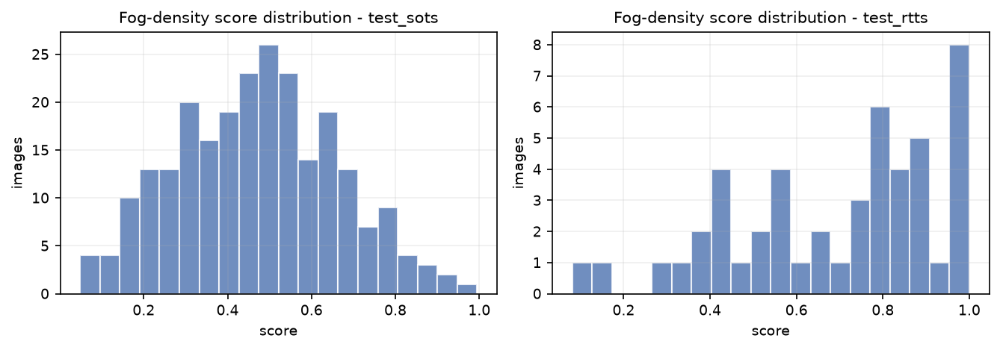
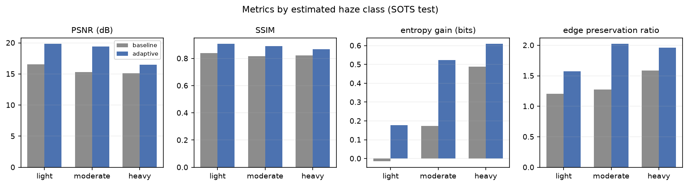
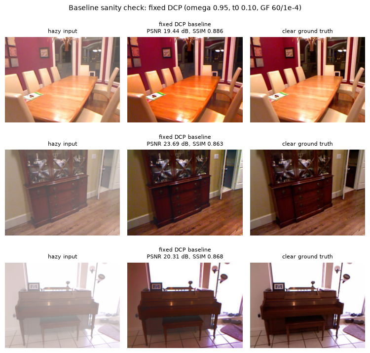

# Adaptive, Fog-Density-Aware Single-Image Dehazing

**IPA course project — report draft**

> Every numeric value in this report is generated from files under `results/`.
> Regenerate with `./run_all.ps1` (or the individual scripts listed in the README).

---

## Abstract

Haze scattering reduces contrast and colour fidelity, and a fixed-parameter dehazer
applies the same correction to light and dense fog. We present a classical,
density-aware pipeline that estimates a fog-density score from three image statistics,
selects a light / moderate / heavy strategy, applies Dark Channel Prior (DCP) dehazing
with class-specific parameters refined by a guided filter, and then optionally applies
Retinex illumination correction, CLAHE and gray-world colour correction. We compare
the adaptive pipeline against a fixed-parameter DCP baseline. On 243 held-out SOTS
pairs the adaptive pipeline improves PSNR from 15.71 dB to 18.78 dB and SSIM from
0.8263 to 0.8896, with a 96.3% PSNR win rate and improvements in every estimated haze
class. We also report a no-reference real-world RTTS set, component/feature/selector
ablations, runtime and failure cases.

---

## 1. Introduction

Fog and haze scatter and attenuate light before it reaches the camera. The observed
image can be described by the atmospheric scattering model:

```
I(x) = J(x) t(x) + A (1 - t(x)),    t(x) = exp(-beta d(x))
```

where `J` is the clear scene radiance, `A` the atmospheric light, `t` the transmission
and `beta d(x)` the optical depth. Inverting the model requires estimating `A` and `t`.

A standard Dark Channel Prior (DCP) uses one fixed correction strength for every
image. On light haze this over-corrects (dark, unnatural results, lost colour); on dense
haze it under-corrects. The project hypothesis is that **estimating fog density first
and adapting the correction strength and enhancement strategy** yields more consistent
results across haze levels.

Contributions:

1. A label-free fog-density score built from dark-channel mean, entropy and contrast,
   normalised on a calibration split and validated against known `beta`.
2. A rule-based, per-class parameter selector with two optional ablations
   (continuous interpolation, shallow decision tree).
3. A fully reproducible classical pipeline and evaluation harness with per-class
   PSNR/SSIM, no-reference metrics, runtime, ablations and a Streamlit demo.

---

## 2. Related work

**Dark Channel Prior.** He et al. observed that in haze-free outdoor images at least one
colour channel is close to zero in most local patches. The dark channel therefore
estimates haze thickness; transmission is `1 - omega * dark(I/A)` and the scene is
recovered by inverting the scattering model. A transmission floor `t0` limits noise
amplification.

**Guided filter.** He et al. refine the noisy transmission map with an edge-preserving
linear filter. We implement the box-filter version locally, so OpenCV-contrib is not
required.

**CLAHE.** Zuiderveld's contrast-limited adaptive histogram equalisation improves local
contrast with a clip limit that prevents noise amplification. We apply it on the L
channel in LAB to preserve hue and saturation, and blend the equalised luminance with
the dehazed image (strength 0.4) to avoid over-sharpening on benchmark pairs.

**Retinex.** Jobson et al. model illumination as a smooth component; subtracting
Gaussian-blurred log-luminance yields a reflectance-like image. We use multi-scale
Retinex on luminance and preserve colour via a gain map.

**Gray-world.** The average scene colour is assumed gray; per-channel gains remove
residual colour cast after dehazing.

---

## 3. Method

### 3.1 Preprocessing
Images are converted to RGB float32 in `[0, 1]`, resized so the long side is 640 px
(area interpolation for downscaling), and lightly denoised with a bilateral filter
(diameter 5, sigma 20). The same preprocessing is used by baseline and adaptive methods.

### 3.2 Fog-density estimation
For each image we compute:

* **dark-channel mean** with a 15×15 patch (higher = hazier),
* **Shannon entropy** of the grayscale histogram (lower = hazier),
* **global contrast** = mean of RMS contrast and Michelson contrast (lower = hazier).

Each feature is percentile-normalised (`p2`–`p98`) using statistics fitted on the
**calib** split only. The score is

```
score = 0.45 * ndc + 0.30 * (1 - nentropy) + 0.25 * (1 - ncontrast)
```

and lies in `[0, 1]`. The three weights live in `config/params.yaml`; the fitted
normalisation and thresholds live in `config/calibration.json`.

### 3.3 Adaptive strategy selection
Thresholds `t1`, `t2` are the tertiles of the calibration score distribution. Images
below `t1` are **light**, between `t1` and `t2` **moderate**, above `t2` **heavy**.
Each class has its own `omega`, `t0`, guided-filter radius/epsilon, CLAHE clip and
Retinex strength. Parameters are fitted on calib with a constrained two-stage search
(omega × t0, then CLAHE clip × Retinex strength); constraints encode the physical prior
that correction strength increases with density.


Optional variants used as ablations:

* **continuous**: interpolate `omega`, `t0`, CLAHE clip and Retinex strength from the
  score rather than using three bins;
* **classifier**: depth-3 decision tree on the three normalised features, trained on
  labelled synthetic haze.

### 3.4 Dehazing and enhancement
DCP estimates the atmospheric light from the brightest 0.1% of dark-channel pixels,
computes the transmission map, refines it with the guided filter, and recovers radiance
with `J = (I - A) / max(t, t0) + A`. The class-specific enhancement chain is
**Retinex → CLAHE → gray-world**, each step individually switchable.

### 3.5 Evaluation
Full-reference on SOTS: PSNR and SSIM against clear ground truth. No-reference on all
sets: entropy gain, RMS contrast improvement, Sobel edge-preservation ratio and colour
cast. Runtime is measured per image on CPU. Adaptive and baseline are paired by image;
we report win rate and a Wilcoxon signed-rank test.

---

## 4. Experimental setup

| item | value |
|---|---|
| Dataset | SOTS indoor + outdoor (RESIDE), 542 unique clear scenes |
| Calibration | 299 pairs (55%), split by unique clear scene |
| SOTS test | 243 pairs (45%) |
| No-reference set | 72 real RTTS images (RESIDE-beta, no ground truth) |
| Density validation | 8 scenes × 8 beta values = 64 images |
| Image size | long side 640 px |
| Baseline | DCP: omega 0.95, t0 0.10, patch 15, GF r=60 eps=1e-4, no enhancement |
| Adaptive | class-specific params from `config/tuned_params.json` |
| Runtime | CPU, Python 3.12, OpenCV |

The calibration split is used for the density normalisation, tertile thresholds and
the per-class parameter search. The classifier ablation is trained on the separate
180-image synthetic selector set, using the calibration normalisation. Test sets are
evaluated only after `config/tuned_params.json` is written and the repository is
tagged `v0.1-frozen-params`.

Frozen parameters (all fitted on calib only):

| class | omega | t0 | CLAHE clip (blend 0.4) | Retinex strength |
|---|---|---|---|---|
| light | 0.86 | 0.35 | 1.5 | 0.00 |
| moderate | 0.94 | 0.30 | 1.5 | 0.35 |
| heavy | 0.94 | 0.20 | 1.5 | 0.00 |

---

## 5. Results

### 5.1 Density estimation


The density score rises with `beta` for every scene. Overall Spearman correlation and
the stricter within-scene mean are reported in
`results/density_validation_summary.json`. The score distributions per split and per
selected haze class are shown below; the calibration tertiles give three balanced bins.



### 5.2 Baseline vs adaptive

<!-- RESULTS_TABLE_START -->
| split | class | method | psnr | ssim | entropy_gain | contrast_improvement | edge_preservation | total_ms |
|---|---|---|---|---|---|---|---|---|
| test_rtts | all | adaptive |  |  | 0.4165 | 1.2376 | 1.6733 | 205.9191 |
| test_rtts | all | baseline |  |  | 0.0912 | 1.0648 | 1.1967 | 111.0164 |
| test_rtts | heavy | adaptive |  |  | 0.9994 | 1.5693 | 1.9917 | 162.1244 |
| test_rtts | heavy | baseline |  |  | 0.7749 | 1.4211 | 1.5967 | 109.2555 |
| test_rtts | light | adaptive |  |  | 0.0992 | 1.0358 | 1.3885 | 166.5462 |
| test_rtts | light | baseline |  |  | -0.1971 | 0.8918 | 0.9888 | 111.9271 |
| test_rtts | moderate | adaptive |  |  | 0.5391 | 1.3865 | 2.1562 | 432.2989 |
| test_rtts | moderate | baseline |  |  | -0.0773 | 1.0615 | 1.2441 | 110.8238 |
| test_sots | all | adaptive | 18.7750 | 0.8896 | 0.4258 | 1.3095 | 1.8484 | 273.4861 |
| test_sots | all | baseline | 15.7100 | 0.8263 | 0.1929 | 1.2406 | 1.3360 | 95.2135 |
| test_sots | heavy | adaptive | 16.5079 | 0.8672 | 0.6102 | 1.5378 | 1.9581 | 159.2928 |
| test_sots | heavy | baseline | 15.1354 | 0.8225 | 0.4889 | 1.4919 | 1.5858 | 94.2812 |
| test_sots | light | adaptive | 19.8208 | 0.9064 | 0.1774 | 1.1255 | 1.5760 | 163.3359 |
| test_sots | light | baseline | 16.5759 | 0.8399 | -0.0151 | 1.0658 | 1.2070 | 94.6438 |
| test_sots | moderate | adaptive | 19.4352 | 0.8902 | 0.5232 | 1.3156 | 2.0214 | 457.1767 |
| test_sots | moderate | baseline | 15.3221 | 0.8165 | 0.1727 | 1.2217 | 1.2759 | 96.4087 |
<!-- RESULTS_TABLE_END -->




<!-- KEY_FINDINGS_START -->
### Key findings

- **Density validation.** The score is monotone in beta: overall Spearman rho = 0.907; within-scene mean rho = 0.992 (minimum 0.939 across 8 scenes).

- **SOTS overall.** Adaptive PSNR 18.78 dB vs baseline 15.71 dB; SSIM 0.8896 vs 0.8263. Win rate (adaptive > baseline): PSNR 96.3%, SSIM 90.1%.

- **Per class.** light: delta PSNR +3.24 dB, delta SSIM +0.0665, SSIM win rate 90.6%; moderate: delta PSNR +4.11 dB, delta SSIM +0.0737, SSIM win rate 88.0%; heavy: delta PSNR +1.37 dB, delta SSIM +0.0446, SSIM win rate 92.4%.

- **Real RTTS no-reference set (72 images, no ground truth).** entropy_gain delta +0.3253; contrast_improvement delta +0.1728; edge_preservation delta +0.4767.

- **Runtime.** 273 ms/image (3.7 FPS) on CPU, including preprocessing.

- **Ablation.** Full pipeline SSIM 0.8896 vs no-enhancement 0.8726; dark-channel-only density features give SSIM 0.8831 vs full features 0.8896.
<!-- KEY_FINDINGS_END -->

### 5.3 Transmission maps


### 5.4 Runtime


On CPU the full adaptive pipeline takes about 273 ms per 640-px image (3.7 FPS),
compared with about 74 ms for the fixed DCP baseline. The overhead comes from the
density features and the enhancement chain (Retinex is the most expensive step). The
class-specific enhancement settings keep the cost bounded; Retinex is disabled for
light and heavy classes.

### 5.5 No-reference real-world set (RTTS)

The no-reference set contains 72 real RTTS photographs (RESIDE-beta), downloaded
with `scripts/download_rtts.py` from the `fuhao7i/RTTS` mirror (Apache-2.0). RTTS has
no ground-truth clear image, so only no-reference metrics are reported: entropy gain,
RMS contrast improvement, Sobel edge-preservation ratio and colour cast.


### 5.6 Baseline fairness audit

To make sure the fixed DCP baseline is not accidentally handicapped, `scripts/audit_baseline.py`
re-runs it on 20 evenly spaced SOTS test images and compares the default estimator
against alternatives (`results/baseline_audit_summary.csv`):

| baseline variant | PSNR (dB) | SSIM | mean A |
|---|---|---|---|
| current (top-0.1% mean, guided filter r=60) | 15.44 | 0.8330 | 0.941 |
| brightest dark-channel pixel | 15.42 | 0.8332 | 0.943 |
| top-1% mean atmospheric light | 15.59 | 0.8342 | 0.934 |
| no guided filter | 14.59 | 0.7752 | 0.941 |
| native resolution (no resize/denoise) | 17.02 | 0.8546 | 0.939 |

The atmospheric-light estimator and the guided filter are therefore *helping* the
baseline, not hurting it. The native-resolution variant scores higher because the shared
`640 px` preprocessing (resize + bilateral) costs about 1.6 dB on both methods; since
baseline, adaptive and ground truth all use the same preprocessing, the paired comparison
remains fair. Three visual examples are shown below.



---

## 6. Ablations


<!-- ABLATION_TABLE_START -->
| variant | group | n | psnr | ssim | entropy_gain | contrast_improvement | edge_preservation | color_cast_out | runtime_ms |
|---|---|---|---|---|---|---|---|---|---|
| baseline_dcp | baseline | 243 | 15.7100 | 0.8263 | 0.1929 | 1.2406 | 1.3360 | 0.0376 | 74.3596 |
| adaptive_no_enh | component | 243 | 17.7705 | 0.8726 | 0.2428 | 1.3319 | 1.3835 | 0.0337 | 107.6211 |
| adaptive_clahe | component | 243 | 18.1839 | 0.8850 | 0.3697 | 1.3173 | 1.7287 | 0.0339 | 124.8363 |
| adaptive_clahe_retinex | component | 243 | 19.3042 | 0.8840 | 0.5337 | 1.3151 | 2.0560 | 0.0389 | 425.1027 |
| adaptive_full | component | 243 | 18.7750 | 0.8896 | 0.4258 | 1.3095 | 1.8484 | 0.0187 | 256.7846 |
| density_dc_only | density_features | 243 | 18.4767 | 0.8831 | 0.4121 | 1.2985 | 1.8218 | 0.0185 | 249.8421 |
| density_dc_entropy | density_features | 243 | 18.8355 | 0.8901 | 0.4276 | 1.3099 | 1.8496 | 0.0183 | 257.3211 |
| density_full | density_features | 243 | 18.7750 | 0.8896 | 0.4258 | 1.3095 | 1.8484 | 0.0187 | 253.7904 |
| selector_continuous | selector | 243 | 18.8002 | 0.8574 | 0.5385 | 1.2317 | 2.1860 | 0.0170 | 440.3025 |
| selector_classifier | selector | 243 | 18.4006 | 0.8780 | 0.4464 | 1.3053 | 1.8592 | 0.0201 | 318.5575 |
<!-- ABLATION_TABLE_END -->

**Components.** Removing all enhancement lowers SSIM from 0.8896 to 0.8726 and PSNR
from 18.78 to 17.77 dB, so the enhancement chain is doing real work beyond DCP.
CLAHE alone reaches 18.18 dB / 0.8850. Adding Retinex to CLAHE raises PSNR to
19.30 dB but lowers SSIM to 0.8840, showing the expected detail/noise trade-off; the
full pipeline keeps Retinex only for moderate haze and adds gray-world, which gives
the best SSIM (0.8896) and the lowest colour cast (0.0187 vs 0.0389 for
CLAHE+Retinex). This is why the final selector does not simply enable every
enhancement for every class.

**Density features.** Dark-channel-only density reaches 18.48 dB / 0.8831; adding
entropy gives 18.84 dB / 0.8901, and adding contrast gives 18.78 dB / 0.8896. Entropy
therefore carries most of the density signal on SOTS, while contrast is close to
neutral; we keep all three because they are complementary on the beta sweep and on
real low-contrast images. The small 0.0005 SSIM difference between the
entropy-only and full score is within run-to-run and sampling noise, so we do not
claim a significant advantage for the third feature.

**Selector.** Continuous interpolation reaches 18.80 dB but only 0.8574 SSIM,
because it over-enhances some images; the depth-3 classifier reaches
18.40 dB / 0.8780, below the three-bin rule (18.78 dB / 0.8896). The three-bin
selector is therefore retained as the primary method: it is simpler, interpretable
and best on SSIM, while continuous/classifier remain useful ablations.

---

## 7. Failure cases and limitations


* **Sky and white objects** violate the dark-channel assumption; transmission is
  underestimated and these regions darken or shift colour.
* **Night haze** has low illumination and weak colour statistics; the density score is
  less reliable.
* **Noise amplification** occurs in dense haze because `J` divides by a small `t`;
  the `t0` floor trades detail for noise.
* **CLAHE/Retinex** can over-sharpen texture and amplify compression artefacts.
* **RTTS**: real RTTS images carry no clear ground truth, so the no-reference metrics
  only indicate whether detail/contrast entropy increase; they are not a substitute for
  paired PSNR/SSIM. The exact 72-image subset is reproducible with
  `scripts/download_rtts.py`.
* **Haze class on SOTS** is estimated from the density score (SOTS has no per-image
  beta label), so the per-class split is an operational definition, not ground truth.

---

## 8. Conclusion

A density-aware classical pipeline gives a principled way to vary DCP strength and
enhancement across haze levels while remaining explainable and CPU-friendly. The
evaluation harness reports both full-reference and no-reference metrics, per-class
behaviour, ablations, runtime and failure cases, and every number is reproducible from
the committed scripts and CSVs.

---

## References

1. K. He, J. Sun, X. Tang. Single Image Haze Removal Using Dark Channel Prior. CVPR 2009.
2. K. He, J. Sun, X. Tang. Guided Image Filtering. ECCV 2010.
3. K. Zuiderveld. Contrast Limited Adaptive Histogram Equalization. Graphics Gems IV, 1994.
4. D. J. Jobson, Z. Rahman, G. A. Woodell. A Multiscale Retinex for Bridging the Gap
   Between Color Image and Human Vision. IEEE TIP, 1997.
5. B. Li et al. Benchmarking Single-Image Dehazing and Beyond. IEEE TIP, 2019.
