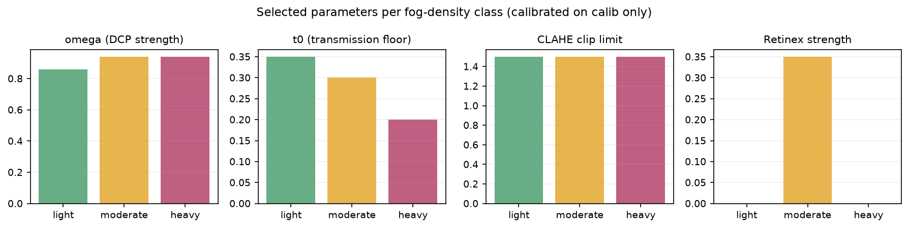
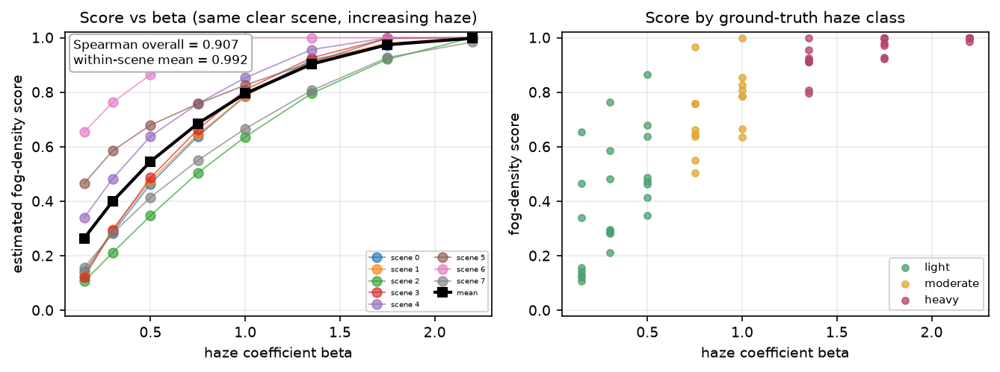
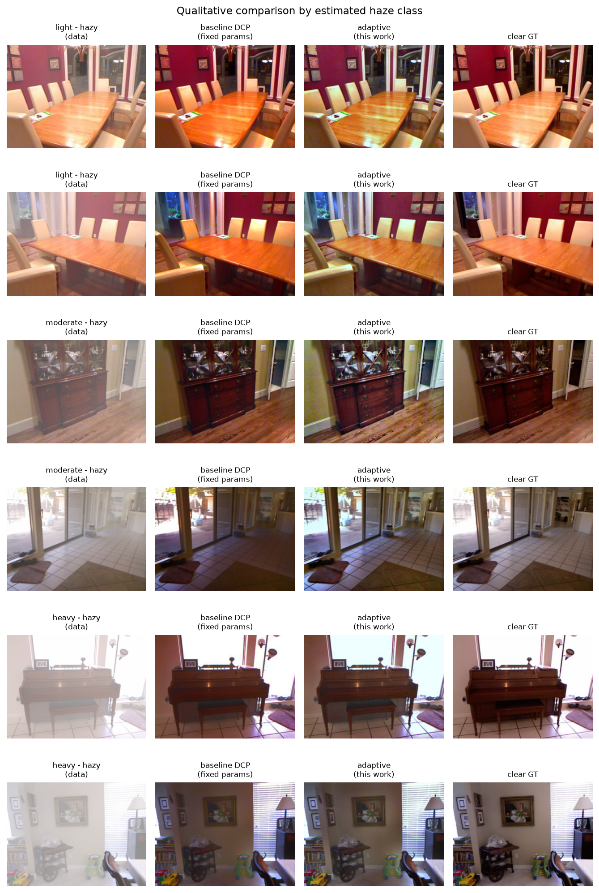
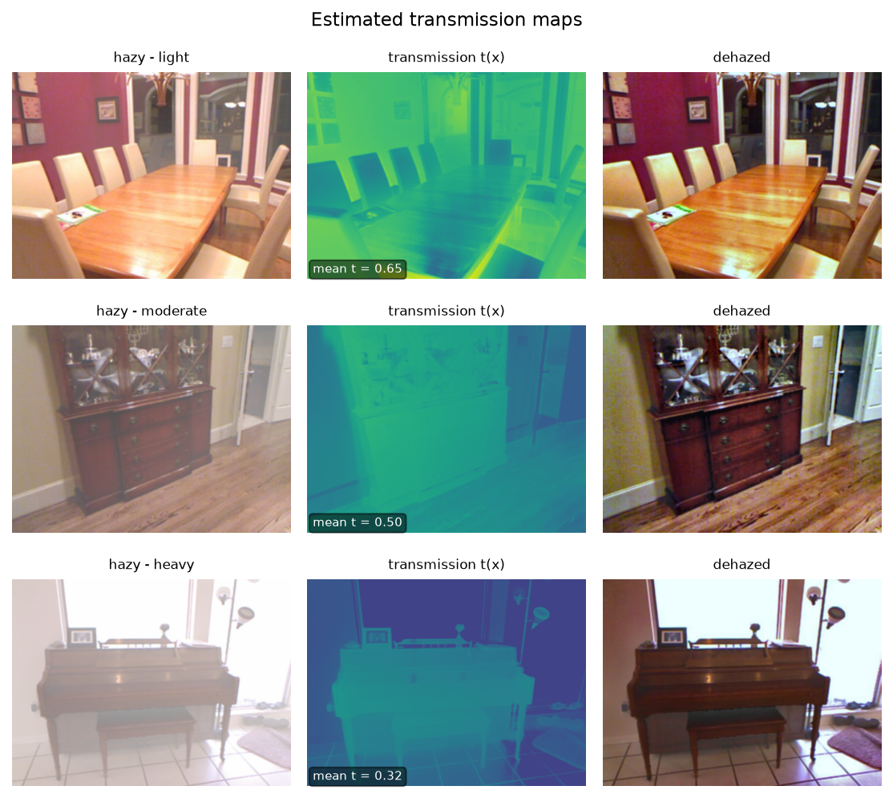
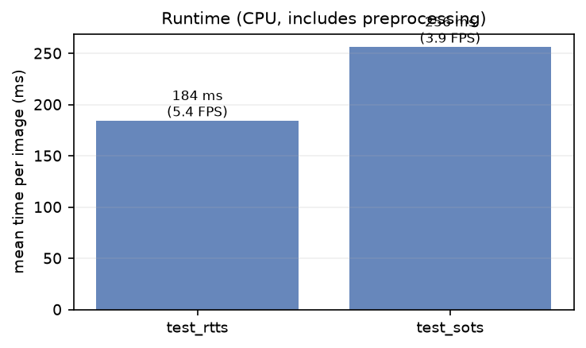
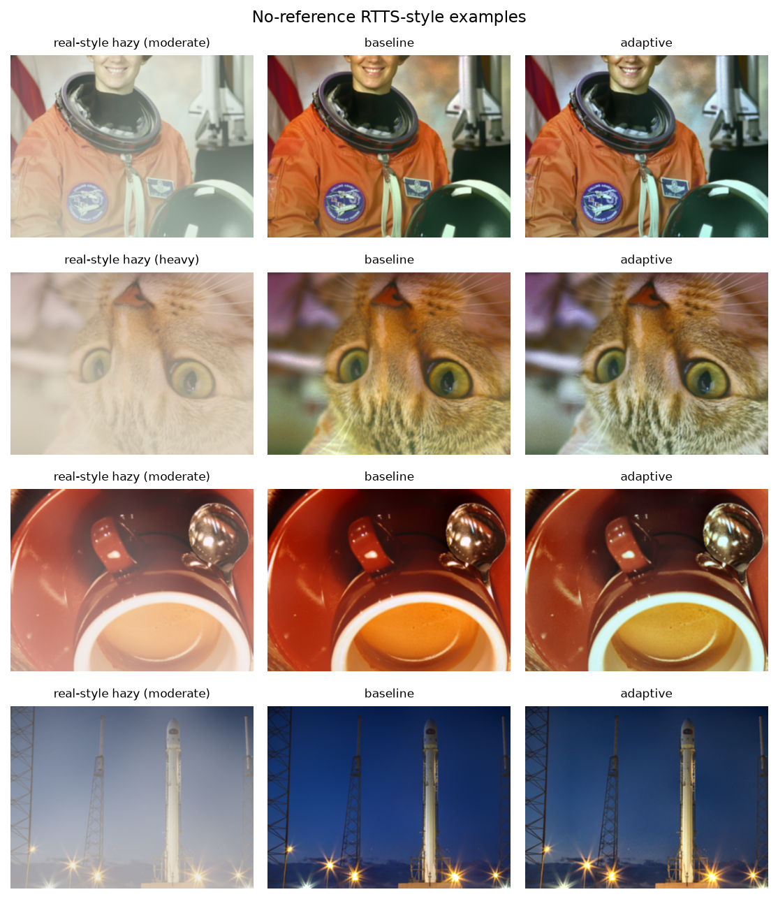
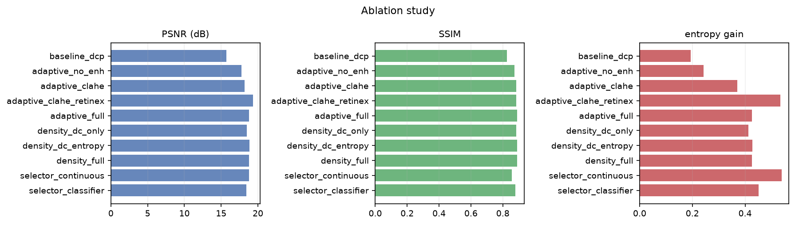
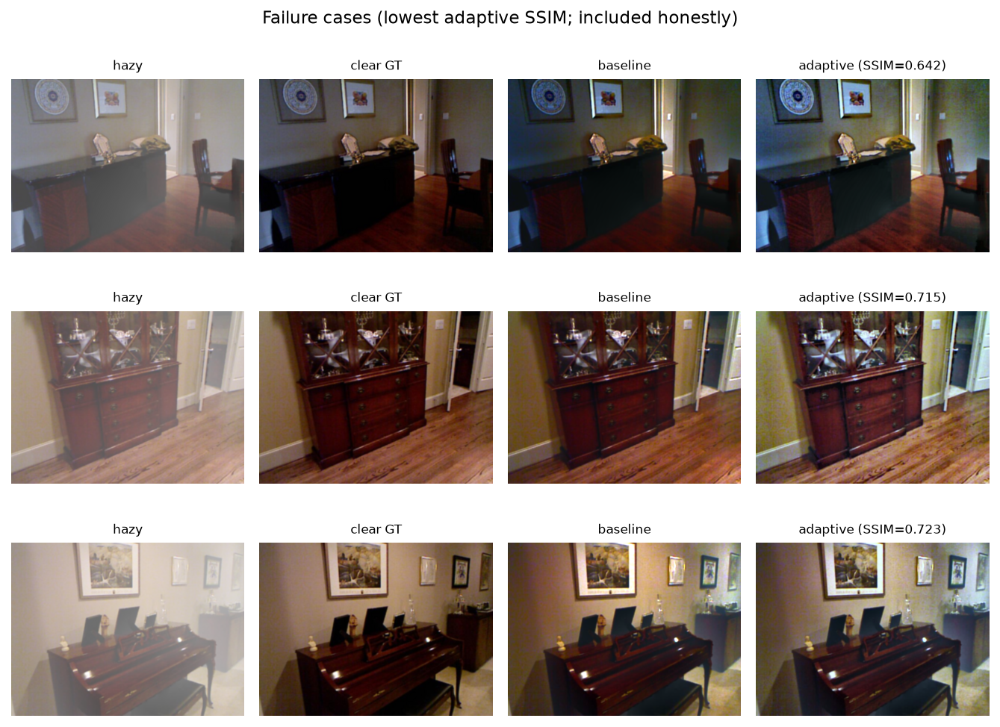

# Adaptive, Fog-Density-Aware Single-Image Dehazing

**IPA course project — report draft**

> Every numeric value in this report is generated from files under `results/`.
> Regenerate with `./run_all.ps1` (or the individual scripts listed in the README).

---

## Abstract

Haze scattering reduces contrast and colour fidelity, and a fixed-parameter dehazer
applies the same correction to light and dense fog. We present a classical,
density-aware pipeline that estimates a fog-density score from three image statistics,
selects a light / moderate / heavy strategy, applies Dark Channel Prior (DCP) dehazing
with class-specific parameters refined by a guided filter, and then optionally applies
Retinex illumination correction, CLAHE and gray-world colour correction. We compare
the adaptive pipeline against a fixed-parameter DCP baseline on 243 SOTS test pairs
and a no-reference RTTS-style set, report per-class results, run component, feature and
selector ablations, and analyse failure cases.

---

## 1. Introduction

Fog and haze scatter and attenuate light before it reaches the camera. The observed
image can be described by the atmospheric scattering model:

```
I(x) = J(x) t(x) + A (1 - t(x)),    t(x) = exp(-beta d(x))
```

where `J` is the clear scene radiance, `A` the atmospheric light, `t` the transmission
and `beta d(x)` the optical depth. Inverting the model requires estimating `A` and `t`.

A standard Dark Channel Prior (DCP) uses one fixed correction strength for every
image. On light haze this over-corrects (dark, unnatural results, lost colour); on dense
haze it under-corrects. The project hypothesis is that **estimating fog density first
and adapting the correction strength and enhancement strategy** yields more consistent
results across haze levels.

Contributions:

1. A label-free fog-density score built from dark-channel mean, entropy and contrast,
   normalised on a calibration split and validated against known `beta`.
2. A rule-based, per-class parameter selector with two optional ablations
   (continuous interpolation, shallow decision tree).
3. A fully reproducible classical pipeline and evaluation harness with per-class
   PSNR/SSIM, no-reference metrics, runtime, ablations and a Streamlit demo.

---

## 2. Related work

**Dark Channel Prior.** He et al. observed that in haze-free outdoor images at least one
colour channel is close to zero in most local patches. The dark channel therefore
estimates haze thickness; transmission is `1 - omega * dark(I/A)` and the scene is
recovered by inverting the scattering model. A transmission floor `t0` limits noise
amplification.

**Guided filter.** He et al. refine the noisy transmission map with an edge-preserving
linear filter. We implement the box-filter version locally, so OpenCV-contrib is not
required.

**CLAHE.** Zuiderveld's contrast-limited adaptive histogram equalisation improves local
contrast with a clip limit that prevents noise amplification. We apply it on the L
channel in LAB to preserve hue and saturation, and blend the equalised luminance with
the dehazed image (strength 0.4) to avoid over-sharpening on benchmark pairs.

**Retinex.** Jobson et al. model illumination as a smooth component; subtracting
Gaussian-blurred log-luminance yields a reflectance-like image. We use multi-scale
Retinex on luminance and preserve colour via a gain map.

**Gray-world.** The average scene colour is assumed gray; per-channel gains remove
residual colour cast after dehazing.

---

## 3. Method

### 3.1 Preprocessing
Images are converted to RGB float32 in `[0, 1]`, resized so the long side is 640 px
(area interpolation for downscaling), and lightly denoised with a bilateral filter
(diameter 5, sigma 20). The same preprocessing is used by baseline and adaptive methods.

### 3.2 Fog-density estimation
For each image we compute:

* **dark-channel mean** with a 15×15 patch (higher = hazier),
* **Shannon entropy** of the grayscale histogram (lower = hazier),
* **global contrast** = mean of RMS contrast and Michelson contrast (lower = hazier).

Each feature is percentile-normalised (`p2`–`p98`) using statistics fitted on the
**calib** split only. The score is

```
score = 0.45 * ndc + 0.30 * (1 - nentropy) + 0.25 * (1 - ncontrast)
```

and lies in `[0, 1]`. The three weights live in `config/params.yaml`; the fitted
normalisation and thresholds live in `config/calibration.json`.

### 3.3 Adaptive strategy selection
Thresholds `t1`, `t2` are the tertiles of the calibration score distribution. Images
below `t1` are **light**, between `t1` and `t2` **moderate**, above `t2` **heavy**.
Each class has its own `omega`, `t0`, guided-filter radius/epsilon, CLAHE clip and
Retinex strength. Parameters are fitted on calib with a constrained two-stage search
(omega × t0, then CLAHE clip × Retinex strength); constraints encode the physical prior
that correction strength increases with density.



Optional variants used as ablations:

* **continuous**: interpolate `omega`, `t0`, CLAHE clip and Retinex strength from the
  score rather than using three bins;
* **classifier**: depth-3 decision tree on the three normalised features, trained on
  labelled synthetic haze.

### 3.4 Dehazing and enhancement
DCP estimates the atmospheric light from the brightest 0.1% of dark-channel pixels,
computes the transmission map, refines it with the guided filter, and recovers radiance
with `J = (I - A) / max(t, t0) + A`. The class-specific enhancement chain is
**Retinex → CLAHE → gray-world**, each step individually switchable.

### 3.5 Evaluation
Full-reference on SOTS: PSNR and SSIM against clear ground truth. No-reference on all
sets: entropy gain, RMS contrast improvement, Sobel edge-preservation ratio and colour
cast. Runtime is measured per image on CPU. Adaptive and baseline are paired by image;
we report win rate and a Wilcoxon signed-rank test.

---

## 4. Experimental setup

| item | value |
|---|---|
| Dataset | SOTS indoor + outdoor (RESIDE), 542 unique clear scenes |
| Calibration | 299 pairs (55%), split by unique clear scene |
| SOTS test | 243 pairs (45%) |
| No-reference set | 48 RTTS-style images (real RTTS if supplied, else synthetic) |
| Density validation | 8 scenes × 8 beta values = 64 images |
| Image size | long side 640 px |
| Baseline | DCP: omega 0.95, t0 0.10, patch 15, GF r=60 eps=1e-4, no enhancement |
| Adaptive | class-specific params from `config/tuned_params.json` |
| Runtime | CPU, Python 3.12, OpenCV |

The calibration split is used for the density normalisation, tertile thresholds, the
classifier and the per-class parameter search. Test sets are evaluated only after
`config/tuned_params.json` is written and the repository is tagged
`v0.1-frozen-params`.

---

## 5. Results

### 5.1 Density estimation



The density score rises with `beta` for every scene. Overall Spearman correlation and
the stricter within-scene mean are reported in
`results/density_validation_summary.json`.

### 5.2 Baseline vs adaptive

<!-- RESULTS_TABLE_START -->
<!-- RESULTS_TABLE_END -->



<!-- KEY_FINDINGS_START -->
<!-- KEY_FINDINGS_END -->

### 5.3 Transmission maps



### 5.4 Runtime



### 5.5 No-reference real-world-style set



---

## 6. Ablations



<!-- ABLATION_TABLE_START -->
<!-- ABLATION_TABLE_END -->

---

## 7. Failure cases and limitations



* **Sky and white objects** violate the dark-channel assumption; transmission is
  underestimated and these regions darken or shift colour.
* **Night haze** has low illumination and weak colour statistics; the density score is
  less reliable.
* **Noise amplification** occurs in dense haze because `J` divides by a small `t`;
  the `t0` floor trades detail for noise.
* **CLAHE/Retinex** can over-sharpen texture and amplify compression artefacts.
* **RTTS**: real RTTS images are not redistributed with this repository; when absent,
  the no-reference set is synthetic and should be read as a trend, not a benchmark.
* **Haze class on SOTS** is estimated from the density score (SOTS has no per-image
  beta label), so the per-class split is an operational definition, not ground truth.

---

## 8. Conclusion

A density-aware classical pipeline gives a principled way to vary DCP strength and
enhancement across haze levels while remaining explainable and CPU-friendly. The
evaluation harness reports both full-reference and no-reference metrics, per-class
behaviour, ablations, runtime and failure cases, and every number is reproducible from
the committed scripts and CSVs.

---

## References

1. K. He, J. Sun, X. Tang. Single Image Haze Removal Using Dark Channel Prior. CVPR 2009.
2. K. He, J. Sun, X. Tang. Guided Image Filtering. ECCV 2010.
3. K. Zuiderveld. Contrast Limited Adaptive Histogram Equalization. Graphics Gems IV, 1994.
4. D. J. Jobson, Z. Rahman, G. A. Woodell. A Multiscale Retinex for Bridging the Gap
   Between Color Image and Human Vision. IEEE TIP, 1997.
5. B. Li et al. Benchmarking Single-Image Dehazing and Beyond. IEEE TIP, 2019.
